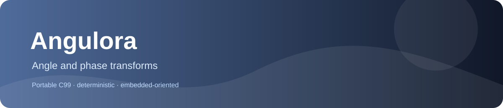

# Angulora
  



Deterministic fixed-point angle, phase, polar/cartesian and motor-angle calculations.

## Why it exists

Embedded control and motion firmware needs bounded angle transforms without floating-point or hidden state.

## What is included

- Portable C99 implementation.
- Deterministic integer or fixed-point behavior documented at function level.
- No mandatory heap, threads or operating-system services.
- Separate translation units for selective linking.

## Quick start

```sh
cmake -S . -B build -DANGULORA_BUILD_TESTS=ON
cmake --build build --parallel
ctest --test-dir build --output-on-failure
```

For a minimal integration, include only the required public header and compile the matching source unit. The library does not require the rest of PrimitiveCore.

## Documentation

| Need | Read |
|---|---|
| Choose a primitive | [Family guide](docs/FAMILY_GUIDE.md) |
| Check every function and contract | [API reference](docs/API_REFERENCE.md) |
| Reproduce tests and see validation limits | [Testing report](docs/TESTING.md) |
| Review design and dependencies | [Architecture](docs/ARCHITECTURE.md) |
| See measured hardware performance data | [Performance](docs/PERFORMANCE.md) |

## At a glance

The public surface consists of eight callable C functions plus the `pc_cpx_q` value type (nine public header entries). Implementations are in `src/`; direct audit tests are in `tests/test_audit.c` and are registered with CTest.

The CMake test option is ANGULORA_BUILD_TESTS. The library has no mandatory third-party dependency. Platform-specific link requirements are documented in CMake and the affected API header.

## Validation status

All eight callable functions and the public `pc_cpx_q` type have direct enabled checks using independent references; the checks remain active in Release. GCC, ClangCL and MSVC Debug/Release passed locally. The ESP32-S3 validation firmware passed 9/9 public header entries. The observed CORDIC maxima were 6, 6 and 7 Q0.32 codes for bearing, Q15 polar and complex polar respectively; these are measured sample maxima, not proven global bounds. Sanitizer and remote CI results are recorded in `docs/TESTING.md`.

Detailed overflow, rounding, invalid-input, memory-ownership and state rules are defined by the public headers and API reference. Do not infer them from the product name alone.

## License

Apache License 2.0, copyright Vanderhell. See [LICENSE](LICENSE) and [NOTICE](NOTICE).

## Origin

A standalone embedded-C library extracted from the PrimitiveCore product catalog. It is independently buildable and linkable.
