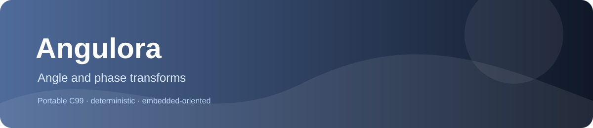

# Angulora
  



Angulora provides deterministic fixed-point angle, phase, polar/cartesian, norm, and motor-angle calculations for embedded C applications.

## Design

- Portable ISO C99 public interface with explicit fixed-width numeric representations.
- Deterministic integer and fixed-point results with documented rounding and failure behavior.
- No mandatory heap allocation, operating-system services, threads, or third-party dependencies.
- Separate implementation units for selective source integration and linking.

## Quick start

```c
#include <stdint.h>
#include <angulora/trigonometry/cartesian_to_polar_q.h>

int main(void)
{
    int32_t radius_q15 = 0;
    uint32_t phase_turns_q0_32 = 0u;
    if (!angulora_cartesian_to_polar_q(16384, 16384,
                                      &radius_q15, &phase_turns_q0_32)) {
        return 1;
    }
    return radius_q15 > 0 && phase_turns_q0_32 != 0u ? 0 : 1;
}
```

The public surface has eight callable operations and the `angulora_cpx_q` value type. API contracts, ranges, aliasing, rounding, and failure semantics are documented in the [API reference](docs/API_REFERENCE.md).

## CMake integration

Build and run validation tests:

```sh
cmake -S . -B build -DANGULORA_BUILD_TESTS=ON
cmake --build build --parallel
ctest --test-dir build --output-on-failure
```

Consume an installed package:

```cmake
find_package(Angulora CONFIG REQUIRED)
target_link_libraries(app PRIVATE Angulora::Angulora)
```

For source-tree use, call `add_subdirectory(path/to/angulora)` and link `Angulora::Angulora`. Tests and examples are disabled by default for dependencies.

## Direct source integration

Include the required header under `include/angulora/trigonometry/` and compile the matching `src/angulora_<operation>.c` translation unit. For example, `cartesian_to_polar_q.h` pairs with `angulora_cartesian_to_polar_q.c`.

## Validation

The test suite includes direct checks for all eight callable APIs, independent numerical references, boundary cases, C99 builds for every public header, and an aggregate C++ header/link smoke. Current host, sanitizer, hardware, performance and memory evidence is reported in [Testing](docs/TESTING.md) and [Performance](docs/PERFORMANCE.md). Previous ESP32-S3 execution is historical evidence for the pre-namespace revision; the current namespaced revision is `HW NOT VERIFIED`.

CORDIC error values are empirical maxima from a documented deterministic sample, not global proofs. See the [family guide](docs/FAMILY_GUIDE.md) for selecting operations and their limitations.

## Versioning

Version 0.2.0 uses the `angulora_` public namespace and namespaced headers. This is a source-level breaking change from 0.1.0; see [Changelog](CHANGELOG.md).

## License

Apache License 2.0, copyright Vanderhell. See [LICENSE](LICENSE) and [NOTICE](NOTICE).
